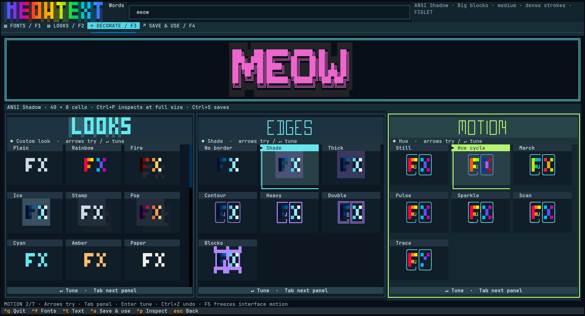
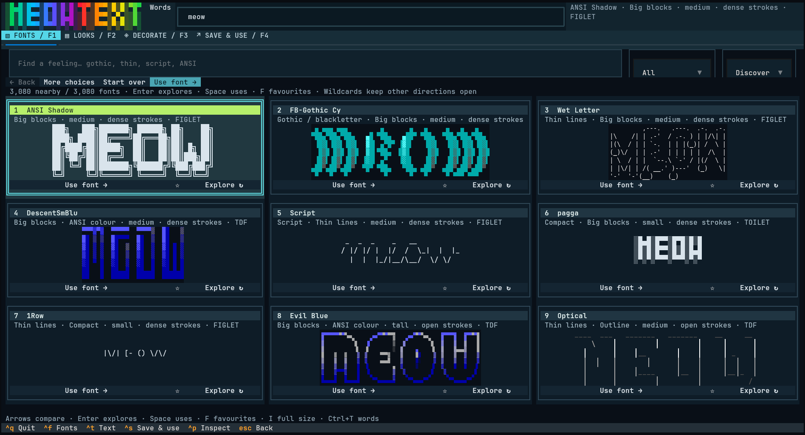

# meowtext

Compare fonts visually, decorate your words, and keep the result—including its animation.

**[Open the browser studio →](https://meow-meow.io/meowtext/)** No installation needed. The Kitty edition is below.

Meowtext is a banner editor for the browser and Kitty on Linux. Both use the same Python compositor, effects, cell rasteriser and export engine. The terminal edition uses FIGlet, TOIlet and TheDraw fonts; the browser bundles 569 FIGlet fonts through PyFIGlet and accepts imported TheDraw `.tdf` files. TOIlet rendering remains available in the Kitty edition.



## Install

You need Kitty, Python 3.12 or newer, FIGlet, and DejaVu Sans Mono. TOIlet adds more fonts.

On Debian or Ubuntu:

```sh
sudo apt install kitty python3-venv figlet toilet fonts-dejavu-core
```

Then install from this repository:

```sh
git clone https://github.com/0xmeowmeow/meowtext.git
cd meowtext
./install.sh
```

Open Kitty and run `meowtext`. If your shell has not picked up the new command yet, run `~/.local/bin/meowtext`.

The installer creates an isolated Python environment and a launcher. It does not resize Kitty or change your terminal theme.

## Make something

1. **Fonts:** compare six rendered choices, or nine in a large window. Arrows move between tiles, **Enter** explores similar shapes, **Space** uses the font, and **F** stars a favourite. Every round includes different directions to explore. Search understands words such as gothic, blackletter, script and thin. **I** inspects the focused font at full size.
2. **Use font → Decorate:** your banner stays above three visual inventories: **Looks**, **Edges** and **Motion**. Each item shows its actual effect. **Tab** switches panels; **arrows** apply a choice immediately. Motion specimens animate. The active panel and item have bright, unmistakable highlights.
3. **Tune:** press **Enter** in a panel to reveal the detailed settings. These also preview immediately; **Escape** returns to the inventory. Solid fills hide gradient controls, disabled borders hide border settings, and each animation shows its relevant controls. Colour roles and painting live in Looks; shadows live in Edges. **Ctrl+Z** undoes an effect change.
4. **Save & use:** the name comes from your words. Changing the name updates the export filename. A custom name or path stays yours. Save, choose where the banner should appear, and press **Copy command**.

`Ctrl+T` edits the words, `Ctrl+F` returns to fonts, `Ctrl+P` inspects at actual cell size, `Ctrl+S` opens Save & use, and `Ctrl+Q` quits. F1–F4 switch sections; F2 compares 28 ready-made looks using your words and font. **Alt+1/2/3** jumps to a decoration panel. **F5** freezes the animated interface specimens and logo. Mouse clicks work too. Small windows scroll to keep the selected item visible; no window dimensions or terminal font sizes are forced.

Font discovery measures shape, weight, size and colour locally, supplemented by familiar font-family names. Its first screen appears immediately while the full catalogue is indexed, then cached. Exploring keeps close alternatives and labelled wildcards, with copies and colour variants grouped out of the comparison. **Browse all** retains every catalogue entry. **Back** restores the previous round exactly. The number of fonts depends on what you have installed; thousands are supported. Discovery helps you explore rather than guaranteeing a particular font in four clicks.

Font previews use native terminal cells whenever they fit. Larger designs are fitted proportionally with Kitty graphics; full-size inspection is always available. PNG export draws block characters as exact cell fractions, so neighbouring cells do not erase or double their strokes.



## Use your designs

After saving a design named `neon`:

```sh
meowtext show neon                         # summon the saved artwork
meowtext show neon "NEW WORDS"             # reuse its font and style
meowtext watch neon                        # play its animation; Ctrl+C exits
meowtext run neon -- ls                    # banner before a command
meowtext run neon --after -- git status    # banner after a command
meowtext frame neon -- htop                # a Kitty window with art above the tool
```

`frame` keeps an animated banner running when the design has motion. It opens a separate Kitty window with two panes and the tool focused. `run` preserves the command's input, output and exit status; the artwork goes to stderr so it does not get mixed into piped data. Commands run directly: shell aliases use the integration below.

To decorate commands and aliases automatically in a Kitty **zsh** session:

```sh
eval "$(meowtext shell zsh --style neon)"
```

For **fish**:

```fish
meowtext shell fish --style neon | source
```

Type `meowtext-off` to stop. These commands apply to the current shell session. Nothing is added to your shell startup files. For a particular command or alias, use `meowtext bind git neon`, then reload the integration. Bindings override the default banner; `meowtext bind git --remove` removes one.

For Markdown, including documents viewed with Glow:

```sh
meowtext show neon --format markdown -o neon.md
glow neon.md
```

Markdown keeps the letter shapes in a code block. ANSI colours belong in terminal output; animated playback uses `watch` or `frame`. Meowtext can decorate the area around another TUI; it does not rewrite that application's internal theme or controls.

## Export what you made

HTML is the default export: a self-contained page with lossless rendered frames, fixed cell alignment, and Pause/Replay controls. It needs no installed fonts or network connection. Colour cycles repeat; trace drawing finishes and holds. Reduced-motion preferences start playback paused on the complete artwork.

| Format | Preserves | Limits shown before export |
| --- | --- | --- |
| HTML | Colours, geometry, borders, shadows, animation | JavaScript is needed for playback; includes a still fallback and text alternative |
| Animated PNG (`.apng`) | Lossless colour and animation | Some image viewers show only the first frame |
| PNG / Kitty | The visible frame, including backgrounds and effects | Still image; animation is lost |
| ANSI | Characters and true colours | Still; receiving terminal controls font and cell geometry |
| IRC | Characters and approximate colours | Still; reduced to 16 IRC colours |
| Text / Markdown | Character layout | Removes colour, painted backgrounds and motion |
| JSON | One frame of cell data | Not a project or animation player |
| `.meowtext` project | Editable recipe, colours, patches and motion settings | Reopen in Meowtext with the original font available |

Pause the preview to choose a PNG still. Animation exports render a complete cycle at editor speed; excessive frame counts or image sizes produce an explanation instead of a silently truncated file. Keep a project as well if you want to edit the work again.

```sh
meowtext export design.meowtext -o design.html
meowtext export design.meowtext -o design.apng
meowtext export design.meowtext --frame 12 -o still.png
meowtext show neon --format html -o neon.html
```

## Effects that carry forward

- Solid colours, named palettes, custom gradient stops, hard bands and six gradient directions.
- Shade, thick, contour, heavy, double and block outlines. Set width, sides, inside/outside placement, whole-word or per-letter scope, offsets, and a separate outline gradient and speed.
- Drop shadows with their own offsets, colour and character.
- Hue cycle, marching gradients, outline pulse, sparkle, scan and trace. Set speed, direction, colour travel and animated layers. Trace supports outline, rows, letters and centre paths, with draw-on or runner behaviour.
- TheDraw colour variants and linked or independent colour roles. Split separate sections into independent roles, focus a role in the preview, and edit named colours or HSV values.
- Cell painting, individual letter edits, undo, and project notes. These change the design, not the font file.
- Existing custom palettes, presets and symbols under the Meowtext configuration directory, and favourites saved by the original editor.

The original editor is also retained as `meowtext legacy`. See [the original editor guide](docs/legacy-editor.md). Existing `.meowtext` projects still open:

```sh
meowtext path/to/design.meowtext
meowtext save neon path/to/design.meowtext
```

A saved library design contains both the editable recipe and a frozen copy of its artwork. The frozen artwork still displays if the original font is later removed. Reusing the style with new words or playing its animation needs that font.

## Fonts and exports

The Kitty edition discovers system FIGlet/TOIlet fonts and `~/.config/meowtext/fonts` automatically. TheDraw `.tdf` files are read directly; the existing `~/.config/tdfgo/fonts` directory is also recognised. `meowtext fonts --fetch` downloads the optional extra FIGlet collection. The browser's PyFIGlet fonts and DejaVu raster font are bundled with their licenses in `web/vendor`; other font packs retain their original terms.

Exports include animated HTML and APNG, PNG stills, ANSI, text, JSON cell data, Kitty graphics, IRC, Markdown and editable `.meowtext` projects. PNG and Kitty previews use DejaVu Sans Mono with geometric block, shade and box-drawing cells.

```sh
meowtext render "MEOW" -f standard --preset sunset-rim
meowtext render "MEOW" -e toilet -f future --gradient ice -o meow.png
meowtext fonts -e tdf -q ice
meowtext styles
```

Designs live in `~/.config/meowtext/library`. `XDG_CONFIG_HOME`, `XDG_CACHE_HOME`, and a direct `MEOWTEXT_HOME` override are supported. Saving over a named design requires explicit replacement; editor exports ask for another path if the file already exists.

## Development

The retained experimental SVG panel tools also need ImageMagick (`sudo apt install imagemagick` on Debian/Ubuntu). Both ImageMagick 6's `convert` and ImageMagick 7's `magick` are supported. CI installs it to test those tools alongside the editor.

```sh
python3 -m venv .venv
.venv/bin/pip install -e .
.venv/bin/python -m unittest discover -s tests
```

The release tests cover font discovery, editor navigation, detailed effects and project round trips, naming, painting, animation playback parity, saved artwork, shell integration and command streams. Experimental instrument renderers remain in the source; their old reference galleries are local research tools, not part of the main editor workflow.

Build the static browser edition with `.venv/bin/python web/build.py --download-runtime`, then serve `web/dist` over HTTP. Subsequent builds reuse the checksum-verified runtime. See [browser build notes](web/README.md).
